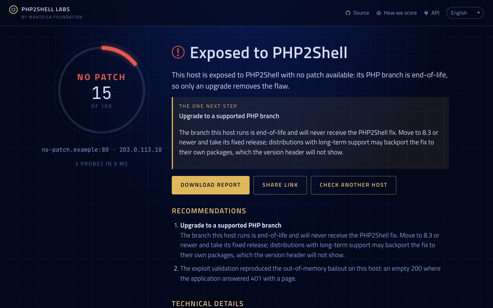
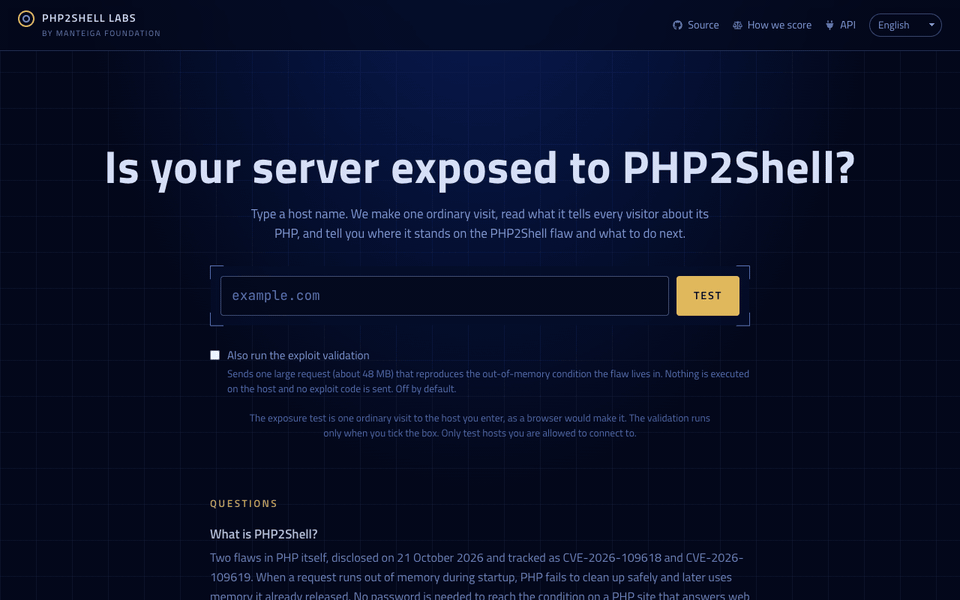

# PHP2Shell Labs

[](https://github.com/manteiga-foundation/php2shell-labs/actions/workflows/ci.yml)
[](LICENSE)
[](https://php2shell-labs.taptok-test.workers.dev)
[](https://php2shell-labs.taptok-test.workers.dev/api)

PHP2Shell Labs answers one question about any public web host: is it exposed to PHP2Shell, the
pair of PHP flaws (CVE-2026-109618 and CVE-2026-109619) disclosed on 21 October 2026 that turn a
large upload into remote code execution? Type a host name, and in about a second the service makes
one ordinary visit to it, as a browser would, reads the PHP version the host advertises, compares it
with the fixed releases and reports in plain language where the host stands and the one next step.
It is built for the people who have to decide and explain, not only for the engineers who will
patch: the result is a stage word (No patch, Exposed, Hidden, Not affected, Protected), a score, and
a report that can be shared by link or downloaded as a five-page PDF. With the operator's consent it
can also validate the exposure with one large request, without sending any exploit code. Free and
open source.





## What PHP2Shell is

PHP2Shell is two flaws in how PHP reads a multipart request. A crafted upload of a few tens of
megabytes drives the PHP process out of memory during the request's parsing; chained with the
second flaw, the bailout becomes code execution. Every PHP from 5.4.0 through 8.5.11 contains the
code. The PHP project fixed the supported branches in 8.5.12, 8.4.27, 8.3.36 and 8.2.35; the
branches 8.1 and older are end-of-life and will never receive the fix, so on those hosts only an
upgrade removes the flaw.

The version decides exposure. A host that hides its version is not patched by hiding it, and a
distribution may backport the fix without changing the version header; the report says both things
plainly.

## The stages

| Stage | Technically | Meaning |
|---|---|---|
| No patch | PHP 5.4 through 8.1 | Inside the affected range on an end-of-life branch. Only an upgrade removes the flaw. |
| Exposed | PHP 8.2 through 8.5.11 | Inside the affected range, and a fixed release exists for the branch. |
| Hidden | PHP runs, version not disclosed | Treated as exposed until the version is known. The validation can place it. |
| Not affected | PHP older than 5.4 | The vulnerable code does not exist in it. The branch is long out of support. |
| Protected | A fixed release or newer | Not exposed to PHP2Shell. |

Two more words cover the cases where the ladder does not apply: Unreachable (no web server
answered) and Not PHP (nothing on the host answered as PHP). Neither carries a score. The rubric,
with the numbers, is in [docs/scoring.md](docs/scoring.md).

## What the test does to a host

The exposure test is passive and runs on every scan: one GET of the front page reads the Server and
X-Powered-By headers, a PHP session cookie and links to `.php` pages, and one GET of PHP's old logo
query (`?=PHPE9568F34-D428-11d2-A769-00AA001ACF42`, answered by PHP 5.4 and older) reads the version
of hosts that still expose it. Two requests, the traffic of one visit, nothing stored about the host
but the result.

The exploit validation runs only with consent (the box under the host field, `--validate` on the
command line, `validate: true` on the API). It sends one small multipart POST as a control, then one
chunked multipart POST of about 48 MB, and compares the two answers: a PHP inside the affected range
dies out of memory on the large request and answers with an empty 200 where the control answered
otherwise. That signature is reported as evidence; no exploit code is sent, nothing is executed on
the host. A host's memory limit can sit above the test size, so "not reproduced" never clears a
vulnerable version. Only test hosts you are allowed to connect to.

## Using it

The web: type a host at https://php2shell-labs.taptok-test.workers.dev, in six languages. Every
result has a permanent link (`/r/<id>`) with a preview, and a PDF.

The API, open and without a key:

```
curl 'https://php2shell-labs.taptok-test.workers.dev/api/scan?host=example.com'
curl -X POST https://php2shell-labs.taptok-test.workers.dev/api/scan \
  -H 'content-type: application/json' -H 'accept: application/json' \
  -d '{"host": "example.com", "validate": true}'
```

The answer is `{id, url, pdf, cached, result}`; `result.assessment` carries the stage, the score,
the verdict and the next step. Without the `accept` header the POST streams the scan's events as
NDJSON. The full description is at `/openapi.json`, a one-screen summary for agents at `/llms.txt`,
the human page at `/api`. Limits: 20 scans per caller address and 6 per host in any hour, 4
validations per caller address in any hour; exposure results under 24 hours old are answered from
the cache, a consented validation always runs fresh.

The command line, from a checkout, for hosts the public scanner must not reach:

```
bun run scan intranet.example:8080 --private
bun run scan example.com --validate --json
```

Exit status 1 when the host is exposed, no patch or hidden, so it fits a pipeline.

## How it is built

- `engine/`: the Bun process that owns the sockets. `target.ts` is the only parser of operator
  input; `resolve.ts` resolves first and refuses non-public addresses; `fingerprint.ts` is the
  passive test; `trigger.ts` the consent-gated validation; `assess.ts` the ladder; `scan.ts`
  streams events; `server.ts` is the HTTP face the edge calls; `cli.ts` and `terminal.ts` the
  command line; `report-html.ts` the PDF's pages. Nothing under `engine/` imports the DOM or a
  framework.
- `worker/`: the Cloudflare Worker. Validation with the engine's parser, DNS-over-HTTPS resolution
  and the refusal list again, rate limits and the result cache in D1, the share pages with their
  previews, the one-answer API, metrics.
- `web/`: Vite and React with Arwes frames. The report builds live from the engine's events; six
  languages pinned by a test; Open Graph images per stage.
- `render/`: one warm Chromium printing the report to PDF, behind a token, on Fly.
- `tests/`: `bun test`. Unit tests against fixture HTTP servers in-process; the worker against
  bun:sqlite standing in for D1; the views in real Chromium with Playwright.

## Development

```
bun install
bun run check        # tsc, three configs
bun run test:unit    # everything but the browser
bun run test         # with the browser tests
bun run dev          # the web on http://127.0.0.1:5190 (?demo=no-patch replays a fixture)
bun run engine       # the engine's HTTP server on 8787
bun run scan <host>  # the engine from the terminal
```

Deployment: `fly.toml` (engine), `fly.render.toml` (renderer), `wrangler.toml` (edge). Secrets
`ENGINE_TOKEN` and `RENDER_TOKEN` are set with `fly secrets set` and `wrangler secret put`, never
written to a file in the repository. The D1 schema is `worker/schema.sql`.

## Licence and contact

MIT. A [Manteiga Foundation](https://manteiga.org) project; the sibling tool for the post-quantum
transition is [Quantum Ready Labs](https://quantumreadylabs.com). Abuse or questions:
hello@manteiga.org.
